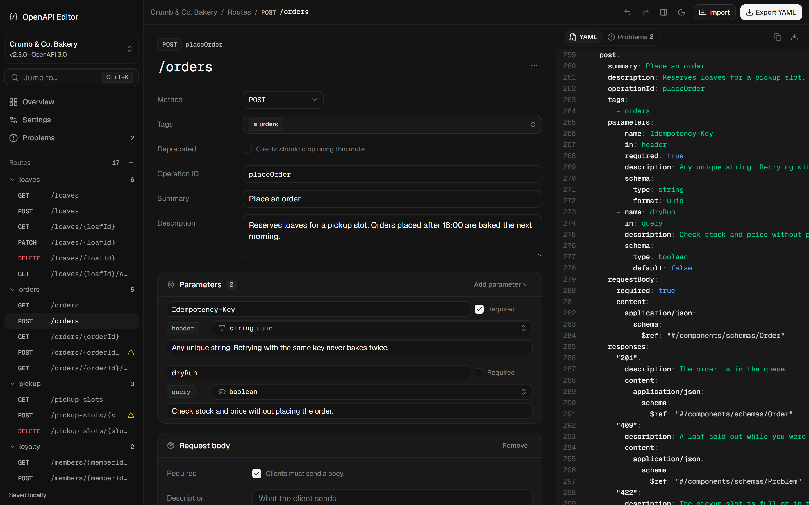
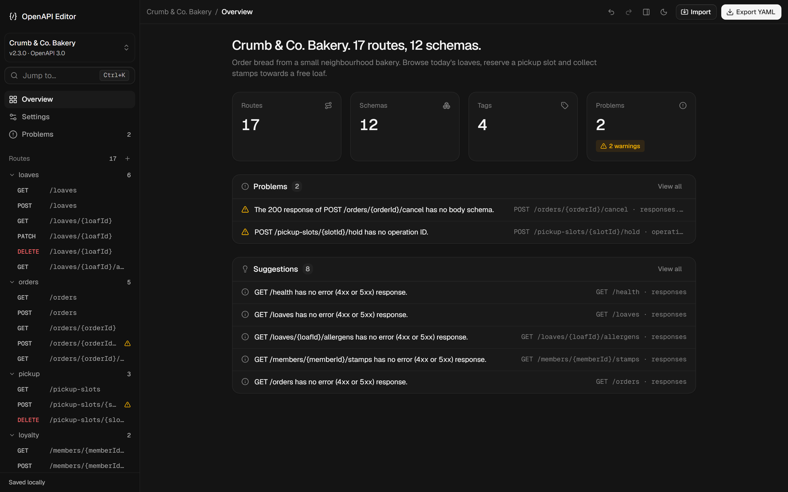
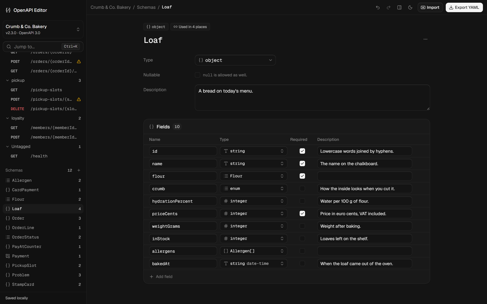
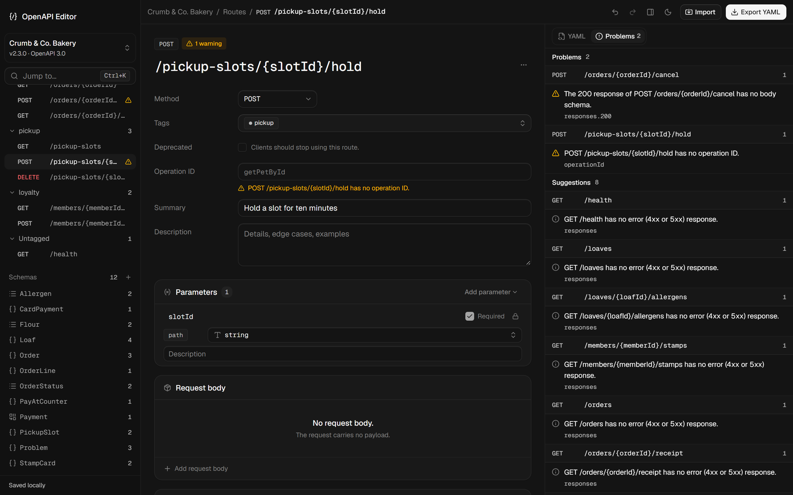
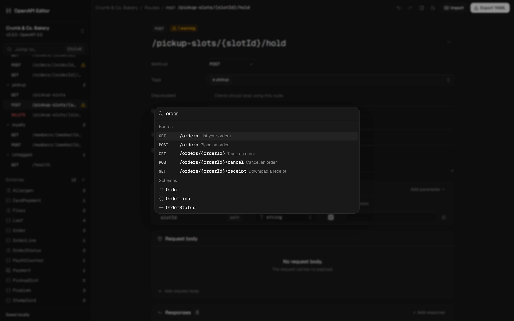
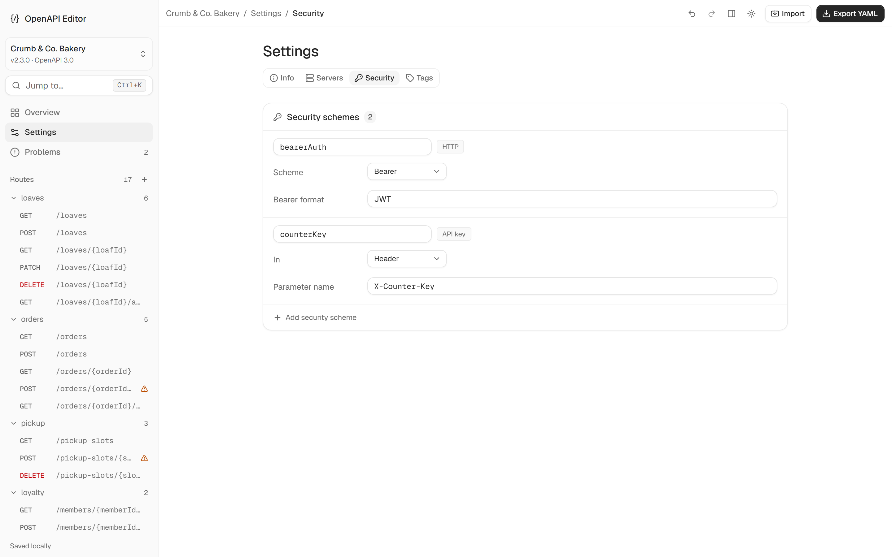
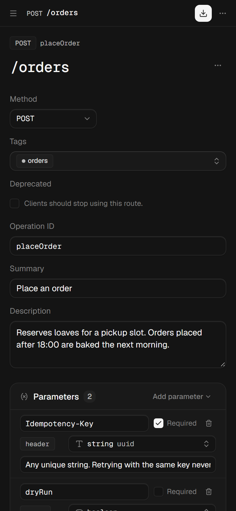
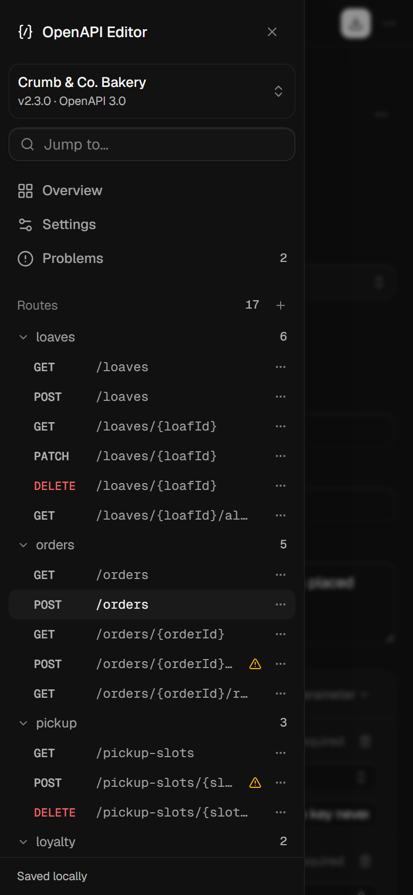

# OpenAPI Editor

A visual editor for OpenAPI 3.0 documents. It runs entirely in your browser, has no accounts and works offline.

<picture>
  <source media="(prefers-color-scheme: light)" srcset="docs/screenshots/route-editor-light.png">
  <source media="(prefers-color-scheme: dark)" srcset="docs/screenshots/route-editor-dark.png">
  
</picture>

## Why

Most OpenAPI editors I've used fall into two camps. Some are text editors that expect you to know the spec and YAML by heart. Others are proprietary or bloated desktop apps with cloud sync, accounts and pricing plans.

This one sits in between. You edit routes, schemas and settings in forms, and the editor writes standard OpenAPI 3.0 YAML for you. Your document stays in your browser. Nothing is uploaded, and there is nothing to sign up for.

## Features

- **Lossless OpenAPI 3.0 import and export.** Paste, upload or fetch a YAML or JSON document, and export it as YAML. Keys the editor does not model, such as `x-*` extensions, `externalDocs`, `examples`, `links` and `callbacks`, are kept and written back unchanged. Anything it cannot keep produces a warning before you import.
- **Visual editors.** A route editor (method, path, tags, parameters, request body, responses), a schema editor (object fields, array items, enums, `oneOf` / `anyOf` / `allOf` with discriminators, constraints) and settings for info, servers, security schemes and tags. Renaming a schema or tag updates everything that refers to it.
- **YAML inspector and problems.** A side panel shows the generated YAML as you type, without a line limit. The Problems tab lists errors and warnings from the validator and links each one to the field it concerns. The same issues appear inline next to the inputs.
- **Command palette.** Jump to any route, schema or settings section, or run an action, from one search box.
- **Undo and redo** for every change, including imports. Typing in one field counts as one step.
- **Local-first autosave.** The document is saved to IndexedDB about a quarter of a second after you stop typing, and again before the page closes. Two tabs editing the same document do not overwrite each other: a tab that falls behind stops saving and asks you to reload.
- **Offline PWA.** After the first visit, the app loads and works without a connection. You can install it from the browser.
- **Responsive.** One layout adapts from a wide desktop to a phone, where the sidebar becomes a drawer and the inspector a full-screen sheet.
- **Large specs.** Measured on a laptop with a generated 14 MB spec of more than 5,000 operations: parsing takes about a second as YAML and half that as JSON, and runs in a worker so the page stays responsive. An edit takes about a millisecond, the YAML view refreshes in 35 to 70 ms, and the autosave after an edit writes in under 10 ms. The sidebar and YAML view are virtualized. `pnpm bench` prints these numbers for your machine.

### Keyboard shortcuts

`Mod` is `⌘` on macOS and `Ctrl` elsewhere.

| Shortcut | Action |
|---|---|
| `Mod` + `K` | Open the command palette |
| `Mod` + `Z` | Undo |
| `Mod` + `Shift` + `Z`, or `Ctrl` + `Y` | Redo |
| `Mod` + `\` | Show or hide the inspector |
| `Mod` + `S` | Save now (the editor also saves on its own) |
| `Esc` | Close the open dialog, drawer or sheet |

### More screenshots

| | | |
|---|---|---|
|  |  |  |
| Overview | Schema editor | Problems |
|  |  |   |
| Command palette | Settings, light theme | Phone |

The screenshots show a fictional bakery API, [`docs/demo/crumb-and-co.yaml`](docs/demo/crumb-and-co.yaml). Import it to try the editor with some content.

## Getting started

You need Node.js 22 or later and pnpm 10. Corepack installs the pnpm version pinned in `package.json`.

```bash
git clone https://github.com/waterrmalann/openapi-editor.git
cd openapi-editor
corepack enable
pnpm install
pnpm dev
```

Open [http://localhost:3000](http://localhost:3000).

Before the first end-to-end run or screenshot capture, install Chromium for Playwright:

```bash
pnpm exec playwright install chromium
```

## Scripts

| Script | What it does |
|---|---|
| `pnpm dev` | Starts the dev server on port 3000. |
| `pnpm build` | Builds the static app into `dist/client/`. |
| `pnpm preview` | Serves the production build on port 4173. |
| `pnpm typecheck` | Type-checks the project with `tsc -b`. |
| `pnpm lint` | Lints with oxlint. |
| `pnpm test` | Runs unit and component tests with Vitest. |
| `pnpm test:watch` | Runs Vitest in watch mode. |
| `pnpm test:perf` | Runs the large-spec performance guard on its own. |
| `pnpm test:e2e` | Builds, serves and runs the Playwright tests (desktop and phone). `E2E_DEV=1` uses the dev server, and `E2E_BASE_URL` uses a server you started. |
| `pnpm bench` | Prints parse, serialize, edit and save timings for generated specs. |
| `pnpm screenshots` | Captures the README screenshots from the production build. Run `pnpm build` first. |

## Deploy

`pnpm build` writes a fully static site to `dist/client/`. Deploy that folder to any static host. `dist/server/` is only used by `pnpm preview` and is not needed.

The app uses client-side routing, so the host has to serve `index.html` for paths that are not files (an SPA fallback).

**Netlify** (`netlify.toml`):

```toml
[build]
  command = "pnpm build"
  publish = "dist/client"

[[redirects]]
  from = "/*"
  to = "/index.html"
  status = 200
```

**Vercel** (`vercel.json`):

```json
{
  "buildCommand": "pnpm build",
  "outputDirectory": "dist/client",
  "rewrites": [{ "source": "/(.*)", "destination": "/index.html" }]
}
```

**Cloudflare Pages:** set the build command to `pnpm build` and the output directory to `dist/client`. Pages serves `index.html` for unknown paths when the site has no `404.html`, which is the case here.

**nginx:**

```nginx
root /var/www/openapi-editor/dist/client;

location / {
  try_files $uri /index.html;
}

location /assets/ {
  add_header Cache-Control "public, max-age=31536000, immutable";
}

location = /sw.js {
  add_header Cache-Control "no-cache";
}
```

Serve `sw.js` without long-term caching on any host, so browsers pick up new versions of the app.

## Tech stack

- [React 19](https://react.dev) and [TanStack Start](https://tanstack.com/start) in SPA mode, with TanStack Router file-based routes
- [Vite 8](https://vite.dev) and TypeScript 7
- [Tailwind CSS 4](https://tailwindcss.com) and [shadcn/ui](https://ui.shadcn.com) components on [Base UI](https://base-ui.com), with the Geist typeface
- [zustand](https://zustand.docs.pmnd.rs) for the document store and UI preferences
- [js-yaml](https://github.com/nodeca/js-yaml) for parsing and writing YAML
- [cmdk](https://cmdk.paco.me), [TanStack Virtual](https://tanstack.com/virtual), [react-resizable-panels](https://github.com/bvaughn/react-resizable-panels), [sonner](https://sonner.emilkowal.ski) and [Lucide](https://lucide.dev)
- Vitest, Testing Library, fake-indexeddb, Playwright and oxlint for checks

The visual language is documented in [docs/DESIGN.md](docs/DESIGN.md). How the editor works inside, and the rules that keep it fast, are in [docs/ARCHITECTURE.md](docs/ARCHITECTURE.md).

## Project structure

```
src/
  routes/               file-based routes: overview, routes, schemas, settings
  components/
    app/                shell: sidebar, top bar, command palette, drawer, overview
    route-editor/       route editor and new-route dialog
    schema-editor/      schema editor, type and schema pickers
    settings/           info, servers, security and tags
    import/             import dialog (paste, file, URL)
    inspector/          YAML view, problems list, export
    shared/             page header, panels, chips, confirm and toast helpers
    ui/                 shadcn/ui primitives
  lib/
    openapi/            types, parser, serializer, validator, store, selectors, worker
    openapi/analysis/   debounced validation and YAML, issue mapping
    storage/            IndexedDB repository
    persistence.ts      hydration and autosave
  hooks/                hotkeys, media queries, theme, UI preferences
  sw.js                 service worker template
e2e/                    Playwright tests
bench/                  benchmark for large specs
docs/                   design language, architecture, screenshots, demo spec
scripts/                screenshot capture
```

## Limitations

- **OpenAPI 3.0 only.** A 3.1 document imports with a warning and is edited and exported as 3.0.3. Keywords that only exist in 3.1 are kept as they are but may not be valid 3.0. Swagger 2.0 is not supported.
- **Some parts are kept but not editable.** Server variables, OAuth 2 flows, `links`, `callbacks`, `examples` and `x-*` extensions survive import and export, but you cannot change them in the editor yet.
- **Reusable parameters, responses, request bodies and headers are inlined.** They are copied into each operation that uses them, and unused ones are dropped with a warning.
- **Importing from a URL needs CORS.** The document is fetched by your browser, so the server has to allow cross-origin requests. If it does not, download the file and upload it instead. URL import is unavailable while offline.
- **Documents over 50 MB are refused**, whether you paste, upload or fetch them.
- **Your data lives in this browser only.** There is no sync between devices or browsers. Clearing site data for this site deletes your document. Export often, and keep the YAML in version control.
- **One document at a time.** Importing or starting a new document replaces the current one (you can undo it).

## Contributing

Contributions are welcome. Useful areas include editing server variables and OAuth 2 flows, OpenAPI 3.1 support, accessibility, internationalization and tests.

Before opening a pull request, run:

```bash
pnpm typecheck && pnpm lint && pnpm test
```

For changes to the parser, serializer, store or storage, also run `pnpm test:perf`. For changes to the UI, run `pnpm test:e2e`. Read [docs/ARCHITECTURE.md](docs/ARCHITECTURE.md) first, and follow [docs/DESIGN.md](docs/DESIGN.md) for anything visual.

## License

MIT. See [LICENSE](LICENSE).
